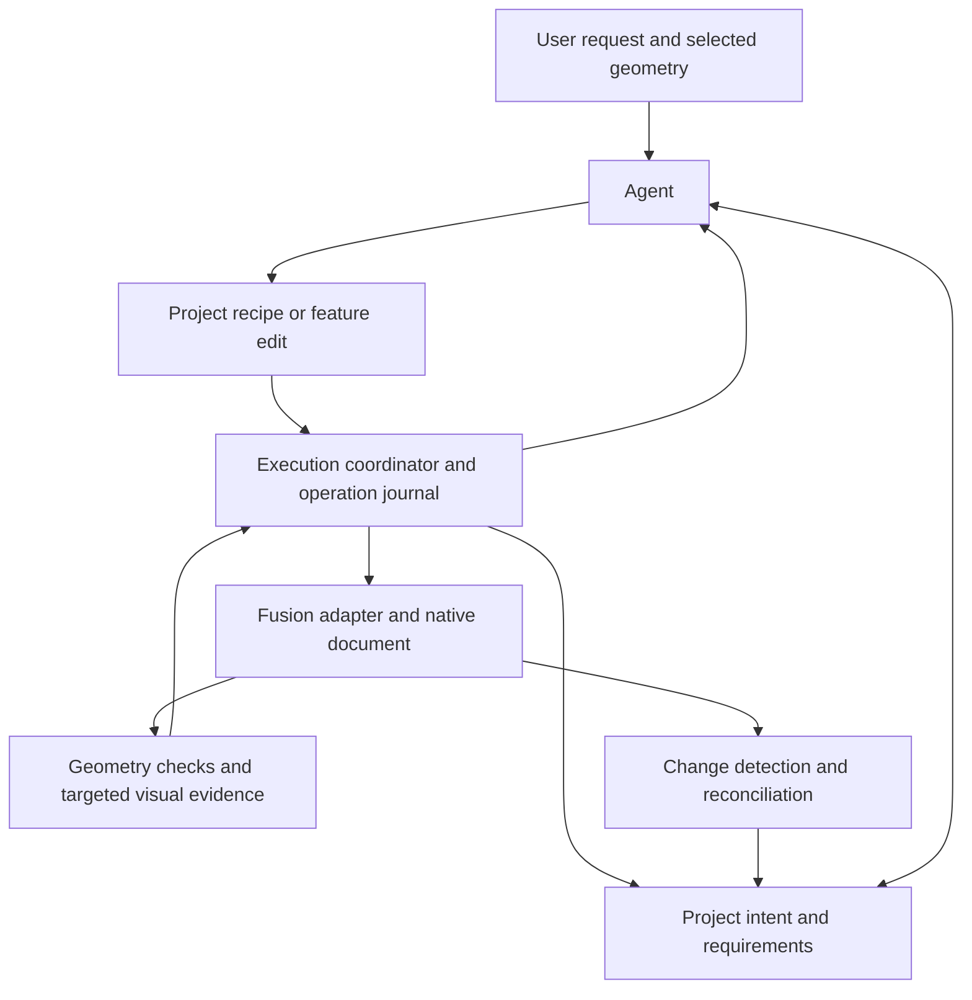

# Plan: an agent that can maintain an engineering design

Written 2026-09-05. Status: implementation in progress; live acceptance gates
remain open. This follows `HANDOFF.md` and a source review of the bridge, studio,
modeling tools, selection layer, and checkpoints. Findings below have not been
reproduced in a live Fusion session during this planning pass.


## Implementation progress

- Source baseline committed as `021096f`; original suites passed 176 core and
  90 studio tests. The staged source was checked for credential-shaped content.
- Implemented bounded lattice/curve/fillet preflight, explicit recovery reports,
  and whole-tool context for failures after earlier successful stages.
- Implemented protocol v4 operation IDs, a durable outcome journal, status polling
  outside Fusion's main thread, queued cancellation, and retry deduplication.
- Mutations require an observed open-document ID and validate it immediately
  before dispatch. Each studio chat owns its client binding. These IDs are
  session-scoped; revision tracking and persistent project identity are pending.
- CLI, studio, and MCP use the shared transport and schema generator.
- Added offline failure-injection tests for timeout/retry, restart, persistence
  failure, document switching, partial cleanup, and complexity limits.
- Native fixture creation, live recovery proofs, complexity calibration, and all
  Phase 2 acceptance work remain pending. A live check found no bridge connection
  metadata. No production CAD document has been changed by this implementation.

See `docs/runtime.md` for the implemented contract and limitations,
`docs/mutation-audit.md` for the recovery audit, and `benchmarks/cases.json` for
fixture requirements. Offline tests do not satisfy the live exit gates below.

## Goal and first milestone

Build an agent that can understand an existing mechanical design, make useful
changes, verify the engineering relationships, recover from failures, and leave
an understandable, editable native Fusion document.

The first major milestone is this complete workflow:

1. Open a saved frame assembly with a bellypan and imported corner modules.
2. Ask: "Make the frame two inches narrower, keep the modules in the corners,
   preserve mounting clearances, and update the bellypan."
3. Update driving dimensions and dependent features without duplicating parts
   or replacing unrelated work.
4. Report the changed dimensions and any requirements that could not be met.
5. Save, reopen, and successfully make another revision.
6. Accept a manual Fusion edit, reconcile the project record, and continue.
7. Recover from an injected failure without silently damaging the starting
   design or repeating an operation whose result is unknown.

Initial scope: mechanical parts and small assemblies similar to the existing
frame and drivebase work. Progress is measured by accepted edits and preserved
relationships, rather than the number of registered tools.

## Architectural decisions

- Keep Fusion as the geometry backend and the native document as the authority
  for actual geometry, features, parameters, and assembly placement.
- Keep the useful separation among pure geometry, selection, modeling
  primitives, and checks. Migrate existing tools incrementally.
- Add a persistent project record for intent, requirements, semantic references,
  provenance, and operation history. Do not duplicate the entire Fusion model.
- Put document binding, operation status, retry handling, and recovery in the
  execution layer. Prompts should not be responsible for enforcing them.
- Store generated design code as versioned project recipes. Promote reusable
  additions into the shared library only after validation.
- Keep the native UI usable. Human edits are expected and must invalidate stale
  assumptions rather than being overwritten on the next agent turn.
- Perform routine checks and recovery automatically. Additional confirmation
  dialogs are not the mechanism for making the agent dependable.



The coordinator can initially remain in the existing local process structure.
This diagram describes responsibilities, not a requirement for new services.

## Phase 0: establish the baseline

### Deliverables

- Establish a reviewed source baseline in Git before implementation changes.
  Inspect the existing index and secret exclusions; do not blindly commit every
  staged file. Keep model fixtures and local credentials out of source commits.
- Create reproducible native Fusion fixtures and a manifest describing their
  units, starting state, required imports, and expected relationships.
- Extend the current benchmark/transcript tooling to identify fixture version,
  recipe version, model settings, and final outcome.
- Record failures from real executions as regression cases. Keep unit tests and
  live Fusion acceptance tests distinct.

### Initial benchmark cases

| Case | Evidence of success |
|---|---|
| Build a simple mounting plate | Editable features, correct dimensions and hole spacing |
| Resize an existing plate | Dependent holes move correctly; unrelated features survive |
| Resize the frame assembly | Rails, bellypan, modules, and mounting interfaces stay consistent |
| Mate a motor to an interface | Correct axis, facing direction, depth, and permitted motion |
| Introduce a failing operation | Recovery result is measured and the design state is explicit |
| Interrupt an operation or lose its response | No duplicate mutation on retry |
| Save, reopen, and continue | References and intent remain usable |
| Make a manual edit and continue | Stale state is detected and reconciled |

Use known fixture dimensions and independently specified requirements as the
oracle. A generator's own output is not sufficient evidence of correctness.

### Metrics and exit gate

Record completion, human corrections, wall time, model cost, kernel time,
inspection time, repeated tool calls, recovery outcome, and native editability.
Classify failures as interpretation, reference selection, modeling, verification,
runtime, or recovery failures. Distinguish warnings from failed operations.

Exit when the cases can be restored and rerun with comparable evidence. Preserve
the initial results before changing the architecture. Do not invent latency
targets before measuring the baseline.

## Phase 1: make execution dependable

### 1A. Make current guarantees accurate and bound expensive work

Relevant files: `checkpoints.py`, `tools.py`, `patterns.py`, `AGENTS.md`, `README.md`.

- Audit each mutation as creation, edit, deletion, document action, or external
  effect. Record what its recovery mechanism actually restores.
- Expose recovery status as `restored`, `partial`, `failed`, or `not_attempted`,
  with before/after evidence. Do not infer restoration from timeline count alone.
- Describe multi-stage tools accurately: an inner checkpoint currently does not
  make the entire tool atomic.
- Add preflight counts for lattice cells, sketch curves, and expensive fillets.
  Configure initial limits using measurements from small live examples.
- Return actionable alternatives when a limit is exceeded, such as increasing
  cell size. Do not silently change a requested engineering dimension.
- Correct the brief's universal rollback claim while preserving direct execution
  and immediate recovery where they are supported.

### 1B. Bind and journal operations

Relevant files: `common.py`, `bridge_client.py`, `FusionCadAgent.py`,
`studio/server.py`, `mcp_server.py`. Add an execution/journal module if needed.

Introduce a versioned mutation envelope with:

| Field | Purpose |
|---|---|
| `operation_id` | Stable identity across transport retries |
| `project_id`, `document_id` | Explicit destination; never inferred from a tab name |
| `expected_revision` | Reject stale work before mutation |
| `tool`, `arguments` | Requested change |
| `recipe_version` | Identify the code that produced the change |

- Serialize mutations across every client through the bridge, including studio,
  CLI, and MCP. Check the target again immediately before execution.
- Persist operation state: `queued`, `running`, `succeeded`, `failed`, or
  `outcome_unknown`. Keep recovery status separate from execution status.
- Return the stored status/result for the same ID and payload; reject reuse of
  an ID with different arguments.
- Expose status polling independently of Fusion's busy main thread. Network
  threads may read journal state but must not access Fusion entities.
- A client timeout does not mean the kernel operation failed. Reconnect and
  reconcile before retrying a mutation with an unknown outcome.
- Support cancellation before execution and between bounded stages. Do not
  promise interruption of a synchronous kernel call that cannot be interrupted.
- Version the protocol and migrate callers deliberately. Unbound legacy
  mutations must not bypass document coordination once enforcement is enabled.

### 1C. Implement and prove recovery by operation type

- Keep timeline deletion for supported additive operations.
- Capture previous values for reversible parameter/property edits.
- Investigate native command undo and document-copy/archive restoration for
  destructive or compound edits; select a mechanism only after a live proof.
- Verify restoration against relevant parameters, entities, transforms, and
  requirements. A matching feature count is insufficient.
- If complete recovery cannot be established, report the remaining state and
  reconcile before allowing dependent work.
- Do not allow a rollback to erase a human edit that occurred after the operation
  began. Detect unexpected changes and stop automatic restoration when necessary.

Document revision tracking needs a live feasibility test. It must account for
manual edits, undo/redo, and document switching; timeline depth is not a revision.
Start with an application-owned counter backed by supported change events and
targeted state checks. Document any gaps rather than claiming full isolation.

Protocol changes to `FusionCadAgent.py` require a planned add-in reload and local
repository development; the running agent's `write_file` fence remains intact.
Do not weaken the fence to update the bridge through itself.

### Exit gate

Pass live cases for wrong-tab execution, duplicate requests, a lost response,
failed parameter edits, failed deletions, and failure halfway through a compound
tool. Each case either restores the intended state or explicitly reports an
unresolved state and prevents dependent execution. No silent duplicate changes.

## Phase 2: preserve intent through a real revision

### 2A. Add the smallest useful project record

Introduce a versioned project manifest containing:

- Native document binding and last reconciled revision.
- Driving parameters, expressions, and their native parameter references.
- Semantic roles for components, interfaces, and important features.
- Requirements with units, tolerances, source, and enforcement policy.
- Provenance for imported parts, vendor dimensions, and user assumptions.
- Recipe versions and links to journal entries and evidence artifacts.

Reuse native parameter expressions and dependencies wherever possible. The
manifest adds engineering meaning; it does not maintain a competing geometry
dependency system. Begin with plate width, hole offsets, frame width, bellypan
size, and module mounting interfaces.

Journal each operation before execution and reconcile both Fusion and the
manifest afterward. A crash between geometry modification and manifest update
must leave an explicit pending reconciliation, not a fabricated clean revision.

### 2B. Resolve semantic references

Extend `pick.py` with references combining occurrence path, native entity token,
creating feature, engineering role, and geometric expectations in a declared
coordinate frame.

- Resolve native tokens before comparing entity identity; token strings can
  change for the same entity.
- Revalidate the entity against its intended role after regeneration.
- Return candidates and selection evidence when a reference becomes ambiguous.
  Never silently choose a different face just because it is now highest.
- Treat split/deleted topology explicitly; do not promise universal persistent
  face identity.
- Capture user selection as an entity reference tied to a document revision.

Reference: [Autodesk entity-token documentation](https://help.autodesk.com/cloudhelp/ENU/Fusion-360-API/files/Component_entityToken.htm).

### 2C. Implement native edits and relationship checks

- First support reading/changing native parameters and editing the specific
  sketch dimensions and features required by the benchmark.
- Build new frame elements in meaningful components so assembly placement does
  not require repeated conversion from root bodies.
- Define mounting interfaces with a local frame, mating face, hole pattern,
  insertion depth, and intended motion where relevant.
- Extend verification to alignment, facing, spacing, clearance, and preserved
  relationships. Scope interference checks to relevant occurrences and declared
  allowed contacts.
- Treat automatic joint flipping as one recovery strategy. Both orientations
  can be collision-free; the interface contract determines correctness.
- Define the policy for manual edits: adopt valid changed values, invalidate
  dependent cached facts, and ask a focused question only for incompatible intent.

### Exit gate

Complete the frame-narrowing workflow, save/reopen, and a subsequent manual edit.
The native feature tree remains usable, important references resolve correctly,
and unrelated geometry is preserved. Resume in a fresh conversation using the
project record without requiring the original transcript.

## Phase 3: generalize through project recipes

Relevant files: `ops.py`, `tools.py`, `catalog.py`, `workspace.py`; new project
recipe storage and runner as justified by Phase 2.

- Expose the general primitives already proven by the benchmark: parameter
  edits, constrained sketches, feature edits, patterns, component placement,
  joints, and measurements. Add other operations as real tasks require them.
- Express frame, plate, lattice, and mounting workflows as recipes composed from
  those primitives. Preserve compatibility wrappers for useful existing tools.
- Execute recipes in bounded stages through the same coordinator and checks.
  Recipes must declare affected entities and their recovery strategy.
- Store generated scripts with the project, record their content version, and
  retain the code needed to explain or reproduce a change.
- Keep shared validators outside ordinary project recipe edits. Fixing a shared
  checker requires its own regression evidence.
- Refresh capability discovery when the registry changes; the current studio
  fetches tool specifications once at the start of a run.
- Promote a recipe into the shared library when multiple tasks establish that
  it is reusable. Keep task-specific construction code local to its project.

Exit when previously unseen variations of the benchmark can be solved without
editing core `tools.py` for every variation. Successful recipes must support a
subsequent revision, not merely reconstruct a final shape from scratch.

## Phase 4: improve perception and reduce time to completion

Relevant files: `studio/vision.py`, `studio/server.py`, `tools.py`,
`studio/transcript.py`, `studio/analyze.py`.

- Give visual review the relevant user requirement, affected entities, and
  before/after evidence. Tool arguments alone may encode a mistaken interpretation.
- Add zoom-to-entity, highlighted candidates, orthographic views, and section
  views where supported and useful to the task.
- Keep original captures as retrievable artifacts; retain recent relevant images
  in context and summarize older evidence. Do not permanently discard detail.
- Return structured observations such as `match`, `mismatch`, and `not_visible`,
  with supporting views. An unavailable or inconclusive review is not a pass.
- Use local geometry deltas and targeted checks after routine operations; request
  visual review at meaningful assembly changes, ambiguous results, and final
  acceptance. Measure the policy against the always-capture baseline.
- Cache imported assets by content and import options while tracking placements
  separately. Reusing an asset must still allow intentionally creating another
  occurrence; retry deduplication belongs to the operation journal.
- Compare model/effort choices on the CAD benchmark with settings held fixed.
  Include correction time and failures in cost comparisons.

Exit when benchmark time and cost improve without lowering accepted completion
or increasing missed intent errors. Present raw case results and repeated-run
variation, not only averages from successful runs.

## Implementation order and review boundaries

Use small, reviewable changes with these initial boundaries:

1. Baseline fixtures, metrics, and source checkpoint.
2. Mutation/recovery audit, accurate reporting, and documentation corrections.
3. Lattice complexity limits with small live validation cases.
4. Operation journal, retry semantics, and status API.
5. Document binding, revision validation, and shared mutation coordination.
6. Proven recovery for the specific edits needed by the milestone.
7. Project manifest and semantic references for the plate/frame fixture.
8. Native parameter editing and relationship verification.
9. Full revision, reopen, and human-edit acceptance workflow.
10. Generalized project recipes and targeted perception, guided by measured gaps.

Journal design and document identity must be designed together even if shipped
in separate changes. Do not expose partial coordination as a complete guarantee.
Complete the Phase 2 workflow before expanding the modeling surface broadly.

## Validation and definition of done

Run the existing appropriate checks during implementation:

```sh
/usr/bin/python3 -m unittest discover -s tests
./studio/.venv/bin/python -m unittest discover -s studio/tests -t .
```

Add tests for failure behavior and invariant preservation. Fake Fusion objects
can test protocol logic; they cannot establish actual kernel recovery, native
editability, or persistence across save/reopen. Those require live fixtures and
visual inspection of the affected geometry.

For every completed milestone, retain the starting fixture version, request,
operation log, resulting native artifact, check results, before/after captures,
timing/cost record, and any human corrections. Record incomplete verification
explicitly. Evaluate visually plausible but deliberately wrong cases, including
a collision-free reversed mate and an edit that breaks an unrelated hole pattern.

## Deferred work and open technical decisions

Defer additional CAD backends, a custom geometry kernel, custom model training,
a large assembly graph database, and broad UI redesign until the revision
workflow establishes a measured need. Keep provider support functional; optimize
provider selection after execution and editing failures are observable.

Resolve these questions with bounded live experiments during the relevant phase:

- Which native recovery mechanism restores destructive edits and compound work
  reliably, including unsaved documents?
- Which supported events and state checks detect all relevant manual changes?
- How should document identity survive Save As, duplication, and reopening?
- Which semantic references survive the actual topology changes in the fixture?
- What geometry complexity predicts unacceptable kernel latency?

API-key rotation listed in `HANDOFF.md` remains separate maintenance work; never
copy credentials into project manifests, fixtures, logs, or version control.

The plan is complete when the first milestone is repeatable and measured, and
the same architecture supports unseen revisions without task-specific changes
to the core runtime.
